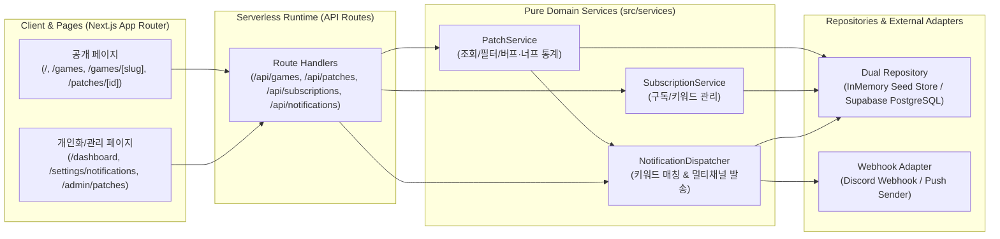

# ARCHITECTURE.md — 서버리스 아키텍처 및 디렉터리 구조 가이드 (PatchRadar)

> **목적 (Purpose)**  
> 본 문서는 **"게임 패치노트 알림 서비스 (PatchRadar)"**의 **시스템 아키텍처, 7대 페이지 라우트 구조, 레이어 분리 원칙, 서버리스 알림 디스패치 패턴**을 정의합니다.  
> 에이전트는 새로운 파일이나 모듈을 생성할 때 반드시 본 문서의 폴더 구조와 의존성 방향을 준수해야 합니다.

---

## 1. 시스템 아키텍처 다이어그램 (Serverless Architecture)



---

## 2. 표준 디렉터리 및 페이지 라우트 구조 (Directory & Route Structure)

```text
.
├── AGENTS.md                           # 마스터 하네스 & 루프 헌법
├── SPEC.md                             # 요구사항, 7대 페이지 구조 및 도메인/API 명세
├── ARCHITECTURE.md                     # 아키텍처 및 디렉터리 구조 (본 문서)
├── HARNESS.md                          # 품질 게이트 및 자동 검증 명세
├── LOOP.md                             # 자율 루프 실행 프로토콜
├── TASKS.md                            # 원자적 작업 큐
├── PROGRESS.md                         # 루프 상태 및 에피소드 메모리
├── src/
│   ├── app/                            # Next.js App Router 페이지 및 서버리스 API
│   │   ├── layout.tsx                  # 글로벌 네비게이션 헤더(홈, 게임목록, 내 대시보드, 알림설정) & 푸터
│   │   ├── page.tsx                    # [Page 1] 홈: 통합 패치노트 피드 & 게임/패치유형 필터
│   │   ├── games/
│   │   │   ├── page.tsx                # [Page 2] 지원 게임 디렉터리 (/games) & 원클릭 구독
│   │   │   └── [slug]/
│   │   │       └── page.tsx            # [Page 3] 게임별 패치 허브 (/games/[slug]) & 키워드 필터
│   │   ├── patches/
│   │   │   └── [id]/
│   │   │       └── page.tsx            # [Page 4] 패치노트 상세 (/patches/[id]): 3줄 요약 & 버프/너프 탭
│   │   ├── dashboard/
│   │   │   └── page.tsx                # [Page 5] 내 구독 피드 & 인앱 알림함 (/dashboard)
│   │   ├── settings/
│   │   │   └── notifications/
│   │   │       └── page.tsx            # [Page 6] 알림 채널 설정 (/settings/notifications): Discord 웹훅 연동
│   │   ├── login/
│   │   │   └── page.tsx                # [Page 7-A] 간편 로그인 / 데모 계정 전환 페이지
│   │   ├── admin/
│   │   │   └── patches/
│   │   │       └── page.tsx            # [Page 7-B] 관리자 패치 등록 & 알림 디스패치 모니터 (/admin/patches)
│   │   └── api/                        # Serverless Route Handlers
│   │       ├── health/route.ts
│   │       ├── games/route.ts
│   │       ├── games/[slug]/route.ts
│   │       ├── patches/route.ts
│   │       ├── patches/[id]/route.ts
│   │       ├── subscriptions/route.ts
│   │       ├── notifications/route.ts
│   │       ├── notifications/channels/route.ts
│   │       └── notifications/test/route.ts
│   ├── components/                     # UI 컴포넌트 계층
│   │   ├── layout/                     # Navbar (읽지 않은 알림 배지 포함), Footer
│   │   ├── ui/                         # Badge, Button, Card, EmptyState, ErrorBanner, Skeleton
│   │   └── features/                   # 도메인 특화 컴포넌트
│   │       ├── patches/                # PatchCard, PatchFilterBar, PatchChangeList (Buff/Nerf 뷰)
│   │       ├── games/                  # GameCard, SubscribeButton
│   │       └── notifications/          # NotificationInbox, DiscordWebhookForm
│   ├── domain/                         # 순수 도메인 모델 및 Zod 스키마
│   │   ├── types/                      # game.ts, patch.ts, subscription.ts, notification.ts
│   │   └── schemas/                    # patch.schema.ts, subscription.schema.ts, channel.schema.ts
│   ├── services/                       # 순수 비즈니스 로직 (Thin Handler, Fat Service)
│   │   ├── game.service.ts
│   │   ├── patch.service.ts
│   │   ├── subscription.service.ts
│   │   └── notification.service.ts     # 키워드 매칭 엔진 및 알림 디스패처
│   ├── repositories/                   # 데이터 접근 추상화 및 시드 데이터 스토어
│   │   ├── seed-data.ts                # 6개 인기 게임 및 실제감 있는 초기 패치노트 시드 데이터
│   │   └── patch-radar.repository.ts   # InMemory(기본/테스트) & Serverless DB 이중 리포지토리
│   └── lib/                            # 공통 서버리스 인프라 유틸리티
│       ├── env.ts                      # 환경변수 런타임 검증
│       ├── auth.ts                     # 서버리스 인증 컨텍스트 추출 (데모 유저/헤더 지원)
│       ├── errors.ts                   # 표준 AppError 클래스
│       └── response.ts                 # 표준 API 응답 엔벨로프 빌더
└── tests/                              # 하네스 자동화 테스트 스위트
    ├── unit/                           # 스키마, 키워드 매칭 엔진, 서비스 로직 단위 테스트
    └── integration/                    # 서버리스 API 엔드포인트 통합 테스트
```

---

## 3. 서버리스 핵심 설계 패턴 (Serverless Design Patterns)

### 3.1 패치노트 키워드 매칭 및 알림 디스패치 엔진 (`NotificationService`)
- 새로운 패치노트(`Patch`)가 등록될 때:
  1. `gameSlug`를 구독 중인 모든 `Subscription` 목록을 조회합니다.
  2. 구독자의 `notify_hotfix_only`가 `true`인데 패치 카테고리가 `'hotfix'`가 아니면 건너뜁니다.
  3. 구독자의 `keywords`가 설정된 경우, 패치의 `title`, `tldr`, `changes[].target`, `changes[].summary` 중 하나라도 대소문자 구분 없이 키워드를 포함하는지 검사하여 `matchedKeywords`를 추출합니다.
  4. 조건을 만족하는 구독자에게 인앱 알림(`Notification`)을 생성하고, Discord Webhook이 설정된 경우 비동기 웹훅 전송(로컬/테스트 모드에서는 안전한 Dry-run 시뮬레이션 지원)을 수행합니다.

### 3.2 무상태성 및 글로벌 시드 스토어 (`src/repositories`)
- 프로덕션 환경에서는 외부 DB(Supabase PostgreSQL)를 사용하며, 로컬 개발 및 하네스 검증(`NODE_ENV=test` 또는 `USE_MOCK_DB !== 'false'`)에서는 풍부한 초기 시드 데이터(LoL, 발로란트, 배그, 오버워치2, 로스트아크, 메이플스토리 패치노트)가 탑재된 `InMemoryPatchRadarRepository`가 즉시 동작합니다.
- Next.js 개발 서버의 HMR(Hot Module Replacement) 중에도 로컬 구독/알림 상태가 유지되도록 `globalThis.__patchRadarStore`에 바인딩합니다.
