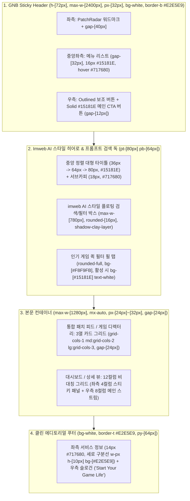

# DESIGN.md — 아임웹(`imweb.me`) UI 심층 분석 및 PatchRadar 디자인 시스템 명세서

> **목적 (Purpose)**  
> 본 문서는 `https://imweb.me/` 공식 사이트 및 아임웹의 내부 디자인 시스템(**Clay Design System**)을 실제 DOM/CSS 수준에서 역공학(Reverse-Engineering)하여 추출한 **타이포그래피, 컬러 토큰, 그리드 배치, 여백, 그림자, 인터랙션 규격**을 정의합니다.  
> 에이전트는 모든 프론트엔드 컴포넌트 및 7대 페이지를 리디자인할 때 반드시 본 문서의 디자인 토큰과 레이아웃 규칙을 단일 진실 공급원(Single Source of Truth)으로 준수해야 합니다.

---

## 1. 아임웹(`imweb.me`) UI 핵심 특징 분석 요약

아임웹(`imweb.me`)의 UI는 **"Light-Only 하이콘트라스트 에디토리얼 미니멀리즘(Editorial Minimalism)"**과 **"Clay Design System"**을 기반으로 설계되어 있습니다.

1. **배경과 서피스의 명확한 명도 대비 (Light-First Surface Hierarchy)**
   - 어두운 배경 대신 **순백색(`#FFFFFF`) 메인 서피스**, **쿨 라이트 그레이(`#F8F9FB` / `#EDF0F4`) 서브 배경**, 그리고 **딥 차콜 슬레이트(`#15181E`) 타이포그래피 & Primary 액션 버튼**의 강한 명도 대비로 세련되고 정돈된 브랜드 감도를 전달합니다.
2. **임팩트 있는 대형 헤드라인과 절제된 본문 스케일**
   - 히어로 타이틀은 데스크톱 `80px`(태블릿 `64px`, 모바일 `36px`)의 압도적인 볼드 타이포그래피(`line-height: 100%`)를 사용하며, 네비게이션과 본문은 `16px`(`line-height: 24px`)과 `14px`(`#717680`)로 가독성과 여백미를 극대화합니다.
3. **'imweb AI' 스타일의 플로팅 프롬프트 카드 & 쉬머(Shimmer) 포인트**
   - 중앙 집중형 카드 박스(`rounded-[16px]`, `1px solid #BCC0C6` 아웃라인, 다중 레이어 소프트 섀도우)와 시그니처 스카이 블루(`#00B9FF`, `#0090D4`) 및 마젠타 핑크(`#FF52C4`) 마이크로 배지로 시선을 유도합니다.
4. **넓은 호흡의 섹션 패딩과 정교한 1px 보더 그리드**
   - GNB 헤더는 높이 `72px`(`px-[32px]`), 본문 섹션은 상하 `80px ~ 120px`의 넉넉한 여백을 가지며, 구분선은 항상 `1px solid #E2E5E9`(`--clay-slate-100`)를 사용합니다.

---

## 2. 색상 시스템 (Color Palette — Imweb Clay Tokens)

아임웹 `clay/vars.css`에서 추출한 실제 색상 팔레트와 PatchRadar 도메인 매핑입니다.

### 2.1 뉴트럴 슬레이트 & 서피스 (Neutral Slate & Surfaces)

| 토큰명 | HEX / RGBA | 아임웹 원본 용도 및 PatchRadar 적용처 |
| :--- | :--- | :--- |
| `--clay-surface` | `#FFFFFF` | 기본 페이지 배경, GNB 헤더, 패치 카드/게임 카드 기본 표면 |
| `--clay-surface-sub` | `#F8F9FB` | 서브 섹션 배경, 카드 내부 요약 박스(TL;DR), 드롭다운/버튼 Hover 배경 |
| `--clay-bg` | `#EDF0F4` | 대시보드 전체 캔버스 배경 또는 구분이 필요한 서브 컨테이너 배경 |
| `--clay-slate-100` (`--clay-divide`) | `#E2E5E9` | 헤더/푸터/카드 기본 구분선 (`1px solid #E2E5E9`) |
| `--clay-slate-200` (`--clay-border`) | `#DBDEE3` | 기본 카드 및 입력 필드 보더 |
| `--clay-slate-300` (`--clay-border-minimal`) | `#BCC0C6` | 플로팅 검색창 외곽선, 비활성(Disabled) 텍스트 |
| `--clay-slate-400` (`--clay-text-minimal`) | `#9FA3AB` | 입력창 Placeholder, 부가 메타 캡션(날짜/시간) |
| `--clay-slate-500` (`--clay-text-sub`) | `#717680` | 서브 타이틀, 본문 보조 설명, 푸터 텍스트, 비활성 탭 |
| `--clay-slate-600` (`--clay-text-secondary`) | `#4B515B` | 아이콘 기본 스트로크(`stroke-width: 1.2`), 본문 중간 강조 텍스트 |
| `--clay-slate-700` | `#24282F` | Primary 버튼 Hover 배경 |
| `--clay-slate-900` (`--clay-text` / `primary`) | `#15181E` | **핵심 타이틀/본문 텍스트**, **Primary 솔리드 버튼 배경** |

### 2.2 브랜드 액센트 & 시맨틱 컬러 (Brand & Semantic Tokens)

| 구분 | Primary / Text HEX | Tonal / Badge BG HEX | PatchRadar 매핑 용도 |
| :--- | :--- | :--- | :--- |
| **Imweb Blue (Accent)** | `#0090D4` / `#00B9FF` | `#ECF9FF` (`rgba(0,185,255,0.10)`) | 브랜드 포인트, 활성 필터, **🛠️ 버그 수정(Bugfix)** & **정기 패치** 배지 |
| **Neon Green (Buff/Success)** | `#00B505` (`#028907`) | `#E8FFE4` (`rgba(0,230,0,0.10)`) | **🔺 상향(Buff)** 배지, 구독 완료 상태, 웹훅 연동 성공 알림 |
| **Coral Red (Nerf/Critical)** | `#ED1515` (`#FF4040`) | `#FFEEEE` (`rgba(255,64,64,0.10)`) | **🔻 하향(Nerf)** 배지, **긴급 핫픽스(Hotfix)**, 미열람 알림 카운터 |
| **Mustard (Adjusted/Warning)** | `#E28100` (`#FFAA00`) | `#FFFBD8` (`rgba(255,170,0,0.12)`) | **🔄 조정(Adjusted)** 배지, **서버 점검(Maintenance)** 시간 안내, 키워드 매칭 하이라이트 |
| **Imweb Pink (Micro Pill)** | `#FF52C4` (`#E316B3`) | `#FFF3FC` (`#FF52C41A`) | GNB/카드 내 **`NEW` / `HOT` / `LIVE`** 마이크로 포인트 배지 (`11px`) |
| **Neon Purple (AI / Summary)** | `#A500E6` (`#9C10BB`) | `#F9E2FF` (`#FDF3FF`) | **AI 3줄 핵심 요약(TL;DR)** 헤더 포인트, **🎉 신규 콘텐츠(New)** 배지 |

---

## 3. 타이포그래피 시스템 (Typography & Font Sizing)

### 3.1 폰트 패밀리 (Font Stack)
- **기본 산세리프 (`--clay-typeface-base`)**:
  ```css
  font-family: "Pretendard Variable", Pretendard, -apple-system, BlinkMacSystemFont, "Segoe UI", Roboto, sans-serif;
  ```
- **버전/코드 폰트 (`--clay-typeface-code`)**:
  ```css
  font-family: "Roboto Mono", ui-monospace, SFMono-Regular, Menlo, monospace;
  ```

### 3.2 아임웹 타이포그래피 스케일 규격

| 레벨 | 토큰명 | 폰트 크기 | 줄간격 (Line-Height) | 굵기 (Weight) | 자간 (Tracking) | 주요 적용 요소 |
| :--- | :--- | :---: | :---: | :---: | :---: | :--- |
| **Display Hero** | `hero-display` | `64px` ~ `80px` *(모바일 `36px`)* | `1.05` (`80px`/`64px`/`44px`) | `700 (Bold)` | `-0.03em` | 메인 홈(`/`) 히어로 타이틀 (*"패치 확인이 쉬운 사이트"*) |
| **Page Title** | `--clay-text-4xlarge` | `36px` *(모바일 `28px`)* | `44px` (`leading-11`) | `700 (Bold)` | `-0.025em` | 각 페이지(`/games`, `/dashboard` 등) 최상단 H1 타이틀 |
| **Section Title** | `--clay-text-2xlarge` | `24px` | `32px` (`leading-8`) | `700 (Bold)` | `-0.02em` | 섹션 헤더, 패치노트 상세 타이틀 |
| **Card Title** | `--clay-text-xlarge` / `large` | `20px` / `18px` | `28px` / `24px` | `600 (Semibold)` | `-0.015em` | 패치노트 카드 제목, 게임 카드 타이틀 |
| **GNB / Body L** | `--clay-text-base` | `16px` | `24px` (`leading-6`) | `400` / `500` | `-0.01em` | 상단 GNB 메뉴 링크, TL;DR 요약 본문, 입력창 텍스트 |
| **Body S / UI** | `--clay-text-small` | `14px` | `24px` (`leading-6`) | `400` / `600` | `0em` | 버튼 라벨, 드롭다운 메뉴, 카드 보조 설명, 푸터 링크 |
| **Caption** | `--clay-text-xsmall` | `12px` | `16px` (`leading-4`) | `500` / `600` | `0em` | 버전 태그(`v14.20`), 버프/너프 카운트 배지, 날짜 메타 |
| **Micro Pill** | `--clay-text-2xsmall` | `11px` | `12px` (`leading-3`) | `600 (Semibold)` | `0em` | GNB/카드 내 초소형 강조 배지 (`px-[6px] py-[4px] rounded-full`) |

---

## 4. 그리드 배치, 레이아웃 및 여백 시스템 (Grid & Layout Architecture)



### 4.1 브레이크포인트 및 컨테이너 규격
- **반응형 분기점 (Imweb Breakpoints)**:
  - Mobile (`max-[599px]`): 1열 스택, 좌우 패딩 `16px`, 헤더 높이 `48px`
  - Tablet (`600px ~ 991px`): 2열 그리드, 좌우 패딩 `24px`
  - Desktop (`min-[992px]`): GNB 풀 메뉴 노출(높이 `72px`, 좌우 패딩 `32px`), 본문 최대 폭 `1280px` (`max-w-7xl`)
- **그리드 간격 (`gap`)**:
  - 카드 그리드 기본 간격: `24px` (`gap-6` / `--clay-space-6`)
  - 섹션 내부 블록 간격: `32px` ~ `48px` (`--clay-space-8` ~ `--clay-space-12`)
  - 섹션 간 상하 패딩: `pt-[64px] pb-[96px]`

---

## 5. 핵심 UI 컴포넌트 스타일 명세 (Component Specifications)

### 5.1 라운딩 (`border-radius`) 및 그림자 (`box-shadow`)
- **버튼 / 인풋 / 드롭다운 메뉴 아이템**: `rounded-[8px]` (`--clay-rounded-base: 8px`)
- **일반 콘텐츠 카드 (`GameCard`, `PatchCard`)**: `rounded-[16px]` (`--clay-rounded-xlarge: 16px`), 기본 보더 `1px solid #E2E5E9`, Hover 시 `border-[#BCC0C6]` 및 소프트 섀도우 전환
- **플로팅 프롬프트 / 드롭다운 레이어 그림자 (`--clay-dropShadow-layer`)**:
  ```css
  box-shadow:
    0px 14px 32px 0px rgba(75, 81, 91, 0.12),
    0px 10px 14px 0px rgba(75, 81, 91, 0.06),
    0px 0px 0px 1px rgba(75, 81, 91, 0.03),
    0px 0px 1px 0px rgba(75, 81, 91, 0.20);
  ```
- **인터랙티브 카드 호버 그림자 (`--clay-dropShadow-card`)**:
  ```css
  box-shadow: 10px 20px 30px 0px rgba(75, 81, 91, 0.08);
  ```

### 5.2 버튼 시스템 (Imweb Clay Button Variants)
1. **Primary Solid Button (`#15181E`)**:
   - 배경 `#15181E`, 텍스트 `#FFFFFF`, `rounded-[8px]`, `px-[16px] py-[10px]`, `text-[14px] font-semibold`
   - Hover: 배경 `#24282F`, Active: `#4B515B`
2. **Accent Tonal / Shimmer CTA Button (아임웹 AI 버튼 모방)**:
   - 배경 `rgba(0, 185, 255, 0.12)` (`#ECF9FF`), 텍스트 `#0090D4`, `rounded-[8px]`, `px-[14px] py-[8px]`, `text-[14px] font-semibold`
   - Hover: 배경 `rgba(0, 185, 255, 0.18)`
3. **Outlined Secondary Button (아임웹 GNB '로그인' 버튼 모방)**:
   - 배경 `#FFFFFF`, 보더 `1px solid #DBDEE3`, 텍스트 `#15181E`, `rounded-[8px]`, `px-[16px] py-[9px]`, `text-[14px] font-medium`
   - Hover: 배경 `#F8F9FB`, 보더 `#15181E`

### 5.3 푸터 구분선 패턴 (Imweb Footer Pipe Divider)
- 아임웹 푸터 특유의 텍스트 간 세로 파이프 구분선:
  ```html
  <span class="inline-block h-[10px] w-px bg-[#E2E5E9] mx-[6px]" aria-hidden="true" />
  ```
- 우측 하단 브랜드 시그니처: `"Start Your Game Life"` (`18px font-semibold text-[#717680]`) + 하트 아이콘 + `"PatchRadar Corp."`
