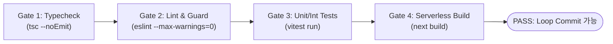

# HARNESS.md — 하네스 엔지니어링(Harness Engineering) 및 품질 게이트 명세

> **목적 (Purpose)**  
> 하네스 엔지니어링의 핵심은 **"에이전트가 스스로 잘못된 코드를 작성했을 때 즉시 감지하고 교정할 수 있는 결정론적(Deterministic) 피드백 환경"**을 구축하는 것입니다.  
> 모든 루프 이터레이션은 본 문서에 정의된 **4단계 검증 게이트(Verification Gates)**를 모두 통과해야만 완료(Done)로 인정됩니다.

---

## 1. 4단계 필수 검증 게이트 (The 4 Verification Gates)

에이전트는 코드 변경 후 반드시 아래 순서대로 검증을 실행합니다. 앞 단계가 실패하면 뒷 단계로 넘어가지 않고 즉시 수정합니다.

### Gate 1: 정적 타입 검증 (Static Type Gate)
- **실행 명령**: `npm run typecheck` (`tsc --noEmit`)
- **통과 기준**: 에러 `0건`.
- **하네스 규칙**:
  - `strict: true`, `noUncheckedIndexedAccess: true` 옵션을 유지합니다.
  - `any` 타입, `@ts-ignore`, `@ts-expect-error`를 사용하여 타입 에러를 회피하는 것을 금지합니다.

### Gate 2: 정적 분석 및 아키텍처 가드 (Lint & Architecture Gate)
- **실행 명령**: `npm run lint` (`eslint . --max-warnings=0`)
- **통과 기준**: 에러 `0건`, 경고(Warning) `0건`.
- **하네스 규칙**:
  - 미사용 변수/임포트 금지.
  - 클라이언트 컴포넌트(`"use client"`)에서 서버 전용 모듈(`src/lib/db.ts`, 서버 전용 환경변수) 임포트 금지.

### Gate 3: 자동화 테스트 게이트 (Automated Test Gate)
- **실행 명령**: `npm run test` (`vitest run`)
- **통과 기준**: 전체 테스트 스위트 100% 통과 (Skipped/Failing 테스트 0건).
- **하네스 규칙**:
  - 새로운 도메인 스키마(`src/domain/schemas`), 비즈니스 서비스(`src/services`), 서버리스 API 핸들러(`src/app/api`)를 작성할 때 반드시 대응하는 테스트 케이스(정상 케이스 + 실패/예외 케이스 최소 1개 이상)를 함께 작성해야 합니다.
  - 외부 네트워크나 실제 클라우드 DB 연결 없이도 로컬에서 단독 실행 가능하도록 Mock/Stub 하네스를 제공합니다.

### Gate 4: 서버리스 빌드 및 번들 검증 (Serverless Build Gate)
- **실행 명령**: `npm run build` (`next build`)
- **통과 기준**: 프로덕션 빌드 및 서버리스 함수 번들링 성공 (Exit Code `0`).
- **하네스 규칙**:
  - 정적/동적 라우트 충돌, Edge 런타임 미지원 Node.js API 오용 여부, 환경 변수 참조 오류를 빌드 단계에서 최종 검출합니다.

---

## 2. 완료의 정의 (Definition of Done - DoD)

단일 태스크(`TASKS.md`의 항목)를 `[x]`로 마킹하기 위해서는 아래 체크리스트를 모두 충족해야 합니다:

- [ ] 태스크의 **Acceptance Criteria(인수 조건)**가 모두 구현되었는가?
- [ ] 해당 기능에 대한 단위/통합 테스트가 추가되었고 실제로 검증하는가?
- [ ] `npm run harness:verify` (Gate 1 ~ Gate 4) 실행 결과가 모두 **PASS**인가?
- [ ] 불필요한 디버그 코드(`console.log`, 임시 파일, 주석 처리된 죽은 코드)가 제거되었는가?
- [ ] `PROGRESS.md`에 작업 결과 및 새로 발견된 제약사항/학습 내용이 기록되었는가?

---

## 3. 서버리스 로컬 모킹 하네스 전략 (Local Serverless Emulation)

에이전트가 클라우드 자격 증명(Credentials)이 없거나 오프라인/샌드박스 환경에서도 루프를 멈추지 않고 검증할 수 있도록 **이중 리포지토리 패턴(Dual Repository Harness)**을 적용합니다.

1. **`InMemoryRepository` (기본 하네스/테스트 모드)**:
   - 환경변수 `USE_MOCK_DB=true` 또는 `NODE_ENV=test`일 때 동작.
   - 초기 시드(Seed) 데이터와 함께 메모리 내에서 트랜잭션/필터링/RLS 조건을 시뮬레이션하여 즉시 테스트 가능.
2. **`ServerlessDbRepository` (프로덕션/스테이징 모드)**:
   - 실제 Supabase / Serverless PostgreSQL과 통신.
   - 동일한 `Repository` 인터페이스를 구현하므로 비즈니스 로직(`src/services`)이나 UI 코드 변경 없이 전환 가능.

---

## 4. 자가 치유 및 회로 차단기 규칙 (Self-Healing & Circuit Breaker)

하네스 검증 실패 시 에이전트는 다음과 같이 행동합니다:

1. **오류 로그 정밀 분석**: 스택 트레이스와 에러 코드의 정확한 파일명/라인 번호를 확인합니다. (추측성 수정 금지)
2. **최대 3회 수정 시도 (3-Strike Circuit Breaker)**:
   - 동일한 에러로 인해 **3회 연속** 검증 게이트 통과에 실패할 경우, 무작위 코드 수정을 즉시 중단합니다.
   - 작업을 마지막 정상 상태로 되돌리고(Rollback), `PROGRESS.md`의 `Blocked / Escalation` 섹션에 **원인 분석과 재현 로그**를 기록한 뒤 루프를 일시 정지하고 사용자에게 보고합니다.
