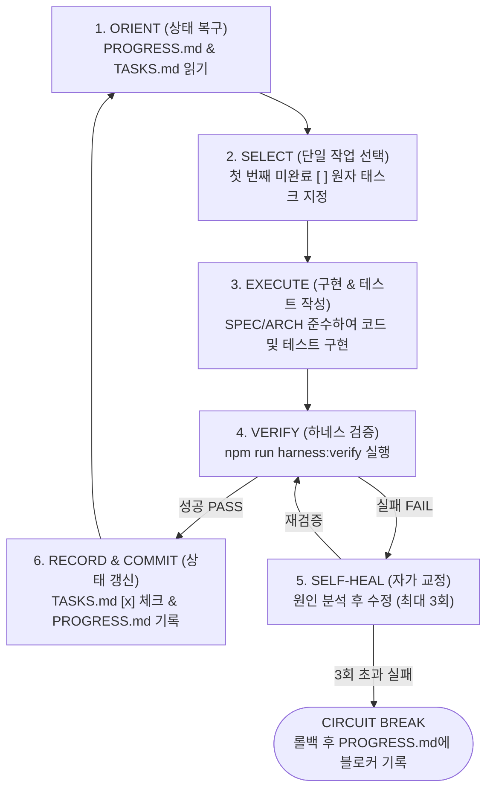

# LOOP.md — 자율 루프 엔지니어링(Loop Engineering) 실행 프로토콜

> **목적 (Purpose)**  
> 루프 엔지니어링은 거대한 프로젝트를 한 번에 작성하려다 발생하는 컨텍스트 오염(Context Rot)과 할루시네이션을 방지하기 위해, **"작고 검증 가능한 단일 루프(Atomic Verified Loop)"**를 반복 실행하여 완성도를 누적하는 공학 기법입니다.  
> 에이전트는 매 이터레이션마다 아래 **6단계 표준 루프 사이클**을 엄격히 수행합니다.

---

## 1. 6단계 표준 루프 사이클 (The 6-Step Loop Cycle)



---

### Step 1: ORIENT (컨텍스트 동기화 및 상태 복구)
- 루프 시작 즉시 다음 파일들을 순서대로 확인합니다:
  1. `PROGRESS.md`: 직전 루프에서 완료된 작업, 현재 프로젝트 상태, **Known Pitfalls (반복 금지 실수 목록)** 확인.
  2. `TASKS.md`: 전체 로드맵 중 현재 진행 중인 Phase와 다음 수행할 태스크 확인.
- 이전 루프에서 미처 끝내지 못한 변경사항(`git status` 또는 작업 디렉터리 상태)이 있는지 점검합니다.

### Step 2: SELECT (단일 원자적 태스크 선택)
- `TASKS.md`에서 선행 조건(Dependencies)이 모두 완료된 **가장 첫 번째 `[ ]` 태스크 1개**만 선택합니다.
- 선택한 태스크의 **Acceptance Criteria(인수 조건)**와 참조해야 할 `SPEC.md` / `ARCHITECTURE.md` 섹션을 확인합니다.
- `PROGRESS.md`의 `Current Active Task`를 선택한 태스크 ID로 업데이트합니다.

### Step 3: EXECUTE (최소 범위 구현 및 테스트 작성)
- 선택한 단일 태스크의 목표를 달성하는 데 필요한 코드만 집중해서 작성/수정합니다.
- **구현과 테스트는 한 몸입니다**:
  - 도메인 로직, 서버리스 API, UI 컴포넌트 작성 시 해당 기능을 검증하는 자동화 테스트(`tests/`)를 반드시 함께 작성하거나 갱신합니다.
- `ARCHITECTURE.md`에 정의된 폴더 구조와 레이어 분리 원칙을 엄격히 지킵니다.

### Step 4: VERIFY (결정론적 하네스 검증 실행)
- `HARNESS.md`에 정의된 4단계 검증 파이프라인을 실행합니다:
  ```bash
  npm run harness:verify
  ```
  *(개별 점검 시: `npm run typecheck` → `npm run lint` → `npm run test` → `npm run build`)*
- 터미널 출력 결과(Exit Code 및 에러 메시지)를 직접 확인합니다.

### Step 5: SELF-HEAL (피드백 루프 기반 자가 치유)
- **검증 실패 시**:
  1. 에러 로그의 정확한 원인을 파악합니다.
  2. 테스트를 삭제하거나 린트/타입 규칙을 끄는 행위(하네스 훼손) 없이 근본 원인을 수정합니다.
  3. 다시 **Step 4 (VERIFY)**를 실행합니다.
- **회로 차단기 (Circuit Breaker)**:
  - 동일 태스크에서 3회 연속 자가 치유에 실패하면 루프를 강제 중단하고 `PROGRESS.md`에 상세 원인을 기록한 뒤 사용자에게 도움을 요청합니다.
  - 해결 과정에서 발견한 중요한 교훈(예: Next.js 특정 버전의 라우트 핸들러 제약, 서버리스 환경변수 주의사항 등)은 즉시 `PROGRESS.md`의 **Error Guardrails**에 추가합니다.

### Step 6: RECORD & COMMIT (상태 영속화 및 다음 루프 준비)
- 모든 하네스 검증 게이트를 통과(PASS)하면:
  1. `TASKS.md`에서 해당 태스크를 `[x]`로 변경합니다.
  2. `PROGRESS.md`의 **Loop History**에 완료된 태스크 ID, 핵심 변경 파일, 검증 결과를 간결하게 기록합니다.
  3. Git 저장소가 초기화된 경우 원자적 커밋을 생성합니다 (예: `feat(T-03): implement item zod schema and unit tests`).
  4. 다음 태스크가 남아있다면 **Step 1**으로 돌아가 다음 루프를 이어갑니다.
